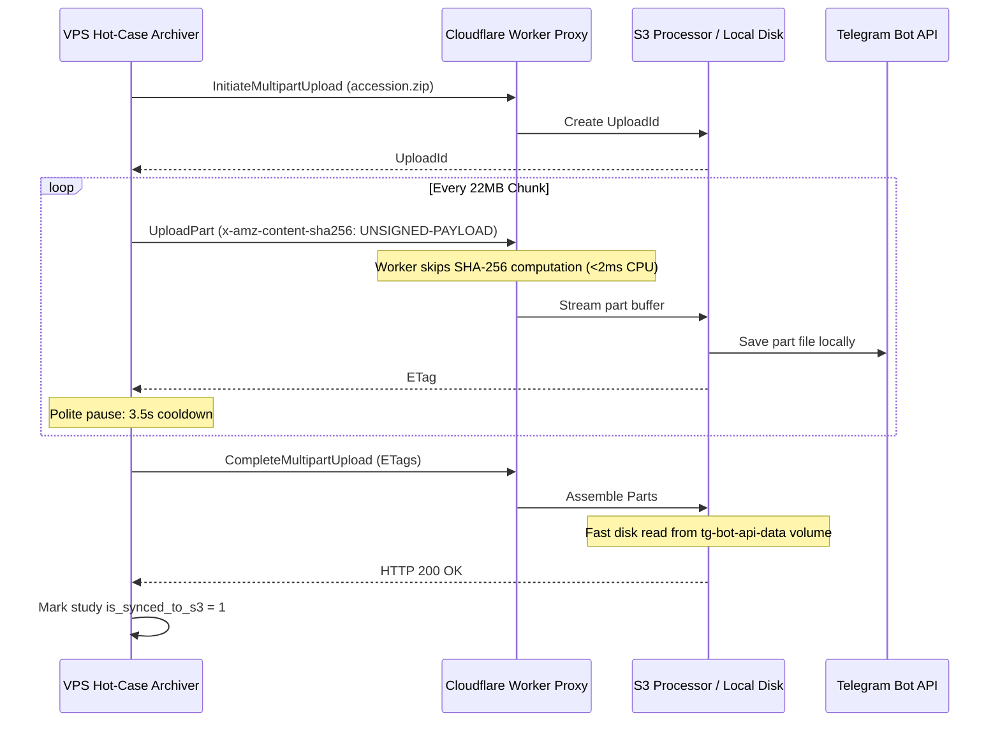

# S3 Cloud Archival, Strict DICOM Staging & Multipart Engine Architecture

## 1. Overview & Problem Definition

In distributed medical PACS operations, transferring hundreds of megabytes of raw DICOM images across hospital edge nodes, Cloudflare proxies, VPS relays, and Telegram S3 storage presents critical failure modes if not properly bounded.

During historical operations, two major architectural breakdowns occurred:
1. **Unbounded Loose DICOM Uploads to S3**: Misconfigured edge nodes uploaded thousands of individual `.dcm` files directly to the Telegram S3 bucket (`https://s3.sehatai.org/rad-suite/dicom/...`), clogging S3 storage, causing rate limit drops, and making study-level access impossible.
2. **Cloudflare Worker CPU Timeout (Error 1102)**: When the VPS attempted to upload large single-file study ZIPs (>80MB) to S3 via Cloudflare Worker reverse proxies, computing WebCrypto SHA-256 and MD5 hashes over 20+ MB buffers inside the Worker isolate exceeded Cloudflare's strict 10–50ms CPU execution cap, dropping multipart chunk uploads.
3. **Local Bot API Multi-Gigabyte 404s**: External S3 storage backends (Telegram Bot API) could not retrieve multi-gigabyte or 50MB parts back over HTTP during `CompleteMultipartUpload`, causing part consolidation failures.

This document codifies the permanent architecture, safeguards, and engineering invariants that prevent these issues from ever recurring.

---

## 2. Invariant 1: Zero Loose DICOM (`.dcm`) Uploads to S3

### The Strict Routing Rule:
* **Hospital Edge Nodes**: Must **NEVER** upload loose `.dcm` files directly to S3 storage (`https://s3.sehatai.org`).
* **VPS Staging First**: Edge nodes MUST exclusively stage downloaded DICOM slices to the VPS over `/api/cases/stage` (or `/api/clinic-node/sync-stage`).
* **VPS as the Sole Archiver**: The central VPS (`radiology.sehatai.org`) is the SOLE entity authorized to archive studies to S3.
* **Consolidated Study ZIP Only**: All DICOM files belonging to a study must be archived into a single consolidated ZIP file:
  ```
  dicom/{accession}.zip
  dicom/{accession}.manifest.json
  ```

### Active Edge Guard (`[S3_GUARD]`):
All edge scripts (`s3-uploader.js`, `uploader-worker.js`, `pacs-harvester.js`) enforce an unbypassable assertion before any upload attempt:
```javascript
if (targetKey.toLowerCase().endsWith('.dcm')) {
  console.error('[S3_GUARD] CRITICAL ATTEMPT TO UPLOAD LOOSE .DCM TO S3 BLOCKED:', targetKey);
  throw new Error('[S3_GUARD] Direct .dcm upload to S3 is strictly forbidden. Staging to VPS required.');
}
```

---

## 3. Invariant 2: High-Performance Multipart Upload Architecture

For studies exceeding 80MB (typically 400 to 1,200 slice MRI studies of 90MB to 250MB+), the VPS `hot-case-archiver.service.ts` uses S3 Multipart Upload (`s3-multipart.service.ts`):



### Key Technical Rules:
1. **`x-amz-content-sha256: 'UNSIGNED-PAYLOAD'`**:
   - Every multipart chunk upload (`UploadPart`), single-part PUT, and `CompleteMultipartUpload` request MUST explicitly include the `x-amz-content-sha256: 'UNSIGNED-PAYLOAD'` header in its SigV4 calculation.
   - When present, the Cloudflare Worker skips hashing `crypto.subtle.digest('SHA-256', bodyBuf)`, reducing isolate CPU execution from >40ms down to <2ms, completely eliminating Cloudflare Error 1102.
2. **Chunk Size (`DEFAULT_PART_SIZE = 22 * 1024 * 1024`)**:
   - Pinned to **22 MB**. Large enough to keep part counts low (e.g. 5–10 parts for a 200MB study), but small enough to fit within memory budgets and single-request upload limits.
3. **Pacing Cooldown (3.5 Seconds)**:
   - Successive part uploads must enforce a 3.5s polite pause (`setTimeout(r, 3500)`) to protect upstream Telegram Bot API rate limits (1 request/sec burst).
4. **Resilient Retry Loop**:
   - Each part upload automatically retries on HTTP 429 (Rate Limited) or HTTP 5xx (500, 502, 503 gateway blips) with exponential backoff before failing.
5. **Modern Native Fetch**:
   - All S3 HTTP transport uses global `fetch()` with `AbortSignal.timeout()` instead of Node's legacy `httpsKeepAliveAgent` connection pooling, preventing socket reuse isolate exhaustion.

---

## 4. Invariant 3: S3 Processor Local Bot API Storage Mount

On the S3 storage host (`s3.sehatai.org`), the `processor` container must mount the Telegram Bot API shared data volume:
```yaml
services:
  processor:
    volumes:
      - tg-bot-api-data:/var/lib/telegram-bot-api:ro
```
When `CompleteMultipartUpload` is called, `processor/server.js` checks if the part's file path exists on the local disk (`filePath.startsWith('/') && existsSync(filePath)`). If present, it reads the part buffer directly from disk via kernel streaming rather than requesting an external HTTP download from the Bot API server. This eliminates 404/413 errors and network exhaustion when consolidating multi-hundred-megabyte archives.

---

## 5. Invariant 4: RadiAnt DICOM ZIP Downloads (Single vs Bulk)

* **Individual Study Download (Recommended)**:
  - Each row in the PACS table includes a dedicated green `[ ⤓ ZIP ]` button.
  - Clicking this button downloads that single study (`${accession}_RadiAnt.zip`) directly from the VPS hot-case staging cache in 1–3 seconds.
* **Bulk Download Guard**:
  - Selecting dozens of MRI cases simultaneously (e.g., 21 cases = 3.5+ GB) and requesting a bulk download will attempt to package gigabytes of DICOM data into a single in-memory buffer.
  - Node.js in-memory buffers are capped at 2GB, and client browser requests time out after 60–120 seconds.
  - Bulk actions must either be queued individually by the client or exported study-by-study to avoid connection timeouts.
