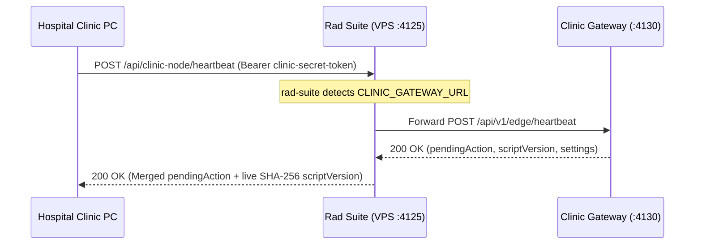

# Clinic Gateway: Standalone Edge Node Hub & Storage Replication Ledger

This document specifies the architecture, data models, communication contracts, and deployment topologies of the standalone **Clinic Gateway** (`clinic-gateway`) microservice.

---

## 1. Architectural Rationale & Separation of Concerns

Historically, clinic node orchestration (receiving periodic HTTP heartbeats, buffering pending administrative actions, and ingesting telemetry) was embedded directly inside the `rad-suite` Next.js server runtime.

While functional, running edge IoT management inside a clinical web workstation created three fundamental bottlenecks:
1. **Workstation Lifecycle Coupling**: Next.js hot-reloads, production rebuilds (`next build`), or aaPanel restarts interrupted in-memory node state, potentially causing missed heartbeats or dropped action queues.
2. **Local Development Friction**: Developers running `npm run dev` on `localhost:3780` had to rely on a complex HTTP/cookie relay (`clinic-relay.service.ts`) to scrape telemetry from the production VPS.
3. **Monolithic Ingestion**: External applications (such as mobile diagnostic suites, standalone DICOM routers, or automated triage scripts) could not interface with hospital clinic nodes without authenticating through Next.js session cookies.

**The Solution**: Just like the Punjab HMIS integration was cleanly isolated into `HMIS-extension/standalone-api`, the edge management tier is now decoupled into an independent microservice: **`clinic-gateway`**.

---

## 2. 3-Tier Distributed Topology

```
┌────────────────────────────────────────────────────────┐
│ TIER 1: ON-PREMISES HOSPITAL EDGE PC (Clinic Nodes)   │
│ • Orthanc DICOM Server (Port 11115 / 18042)            │
│ • RadSuiteEdgeAgent (clinic-agent.js in Session 0)     │
│ • RadSuiteWatchdog (clinic-watchdog.js in Session 0)   │
└───────────────────────────┬────────────────────────────┘
                            │ Outbound HTTPS (Port 443)
                            ▼
┌────────────────────────────────────────────────────────┐
│ TIER 2: STANDALONE CLINIC GATEWAY (Port 4130)          │
│ • Heartbeat Ingress & Reverse-Tunnel Broker            │
│ • Master PACS & Multi-Storage Replication Ledger (SQL) │
│ • Protected Client REST API (API Key Auth)             │
└───────────────────────────┬────────────────────────────┘
                            │ Internal REST / JSON
                            ▼
┌────────────────────────────────────────────────────────┐
│ TIER 3: WORKSTATION & STORAGE ARCHIVE                  │
│ • Rad Suite Workstation (Next.js App Router :4125)     │
│ • Cloud S3 Object Storage (s3.sehatai.org / Wasabi)    │
│ • Mobile Diagnostic Suite / Third-Party EMR            │
└────────────────────────────────────────────────────────┘
```

---

## 3. Master PACS & Multi-Storage Replication Ledger

The Gateway embeds SQLite in **WAL (Write-Ahead Logging)** mode (`better-sqlite3`), providing sub-millisecond query performance and zero server management overhead.

### Data Model

1. **`clinic_nodes`**: Records physical edge node telemetry (disk utilization, Orthanc status, hospital PACS socket latency, S3 write status, sync schedules, `active_download`, `download_queue`, `active_upload`, `upload_queue`, and `inventory_summary`).
2. **`studies`**: The canonical clinical catalog. Enforces composite uniqueness on `(accession_number, modality)` to prevent cross-modality accession collisions (e.g., CT Brain vs MR Brain).
3. **`study_storage_replicas`**: Tracks where each study physically resides across heterogeneous storage tiers:
   - `s3-primary`: Primary Ceph/AWS cloud bucket (`rad-suite`) with Stage 2 (`uploading` / `synced`) slice progress.
   - `s3-backup`: Geographic redundant backup bucket (e.g., Wasabi, MinIO).
   - `local-orthanc`: On-premises edge PC cache on NVMe/HDD storage with Stage 1 (`on_pacs` / `downloading` / `in_sandbox`) slice progress.
   - `gdrive`: Clinical Google Drive archive.
4. **`study_series`**: Canonical sequence-level metadata ledger. Tracks each individual series for every study:
   - `series_number`: Scanner sequence order (e.g., 1001, 3001, 4001).
   - `series_description`: Clinical protocol label (e.g., `AX T2`, `AX FLAIR`, `IsoDWI`, `COR T1 C`).
   - `orientation`: Spatial orientation (`AXIAL`, `SAGITTAL`, `CORONAL`, `LOCALIZER`).
   - `num_instances`: Exact slice count in this sequence.
   - `key_prefix`: S3 or Orthanc path prefix pointing to the slice files.
5. **`pending_actions`**: Durable queue for remote actions (`harvest-pacs`, `pause-sync`, `run-diagnostics`, `update-script`, `exec`).
6. **`command_logs`**: Historical audit log of all remote executions, terminal outputs, and exit codes.

---

## 4. Zero-Breakage Migration & Pass-Through Proxy

To guarantee that the live physical hospital Clinic PC experiences **zero downtime, zero reconfiguration, and zero missed heartbeats**, the migration employs the **Transparent Pass-Through Proxy Pattern**:



1. The hospital Clinic PC continues sending outbound heartbeats to `https://radiology.sehatai.org/api/clinic-node/heartbeat`.
2. Rad Suite's `heartbeat/route.ts` forwards the payload directly to `http://127.0.0.1:4130/api/v1/edge/heartbeat` via `clinic-gateway-client.ts`.
3. The Gateway records the heartbeat in SQLite, pops any queued actions, and returns the response.
4. Rad Suite merges any locally queued `pendingAction` and injects the live `getClinicScriptManifest().version` SHA-256 hash so auto-OTA updates work seamlessly through the proxy.
5. **Graceful Fallback**: If the Gateway is ever offline, Rad Suite automatically handles the heartbeat locally in-memory. Nothing breaks.

---

## 5. Security Architecture

1. **Edge Node Ingress**:
   - Strict outbound-only polling from hospital PC; zero open inbound ports on the hospital firewall.
   - Pre-Shared Key (Bearer token) validated via constant-time buffer comparison (`crypto.timingSafeEqual`) to prevent timing attacks.
2. **Client API Access**:
   - Scoped Bearer API Keys (`CLINIC_GATEWAY_API_KEY`).
   - Rate limiting and payload size bounds (25 MB max body size).
3. **Remote Exec Guardrails**:
   - Shell command execution (`exec:`) is disabled by default (`ALLOW_REMOTE_EXEC=false`).
   - PACS harvest and C-FIND parameters are sanitized against regex allowlists.

---

## 6. Client REST API & Manifest Resolution

All endpoints require `Authorization: Bearer <CLINIC_GATEWAY_API_KEY>`:

1. **`GET /api/v1/studies`**: Multi-criteria query engine supporting `accession`, `modality`, `patientName` (`name`), `mrn`, `originNodeId`, `date`, `startDate` (`from`), `endDate` (`to`), `limit`, `offset`.
2. **`GET /api/v1/studies/:accession/manifest`**: Instant JSON manifest (<5ms) returning study details, storage replication targets, and complete series breakdown (`seriesNumber`, `seriesDescription`, `orientation`, `sliceCount`, `keyPrefix`).
3. **`GET /api/v1/studies/:accession`**: Single study master record with all linked storage replica targets.
4. **`GET /api/v1/nodes`**: Real-time status of all registered clinic edge nodes.
5. **`POST /api/v1/nodes/:nodeId/actions`**: Enqueues remote commands (`harvest-pacs`, `pause-sync`, etc.).
6. **`GET /api/v1/nodes/:nodeId/commands`**: Audit log of executed commands and terminal outputs.

---

## 7. High-Performance Caching & Ingress Acceleration

To eliminate unnecessary API calls and database disk I/O across distributed edge nodes and workstations:

1. **Differential Heartbeat Ingestion (Dirty Hashing)**:
   - Edge agents (`clinic-agent.js`) compute a content hash (`studiesHash`) of `(localStudies, syncedStudies, activeUpload, activeDownload)`.
   - The gateway (`study.service.js`) compares incoming hashes. If identical to the last heartbeat, it **bypasses up to 200 SQL upserts**, responding in `<0.7ms`.
   - Server-side fallback hash calculation is maintained for older un-upgraded edge nodes.
2. **In-Memory LRU & TTL Caching**:
   - `nodes` namespace: Telemetry cached for 3 seconds; invalidated immediately upon heartbeat or action dispatch.
   - `studies` namespace: Query results cached for 10 seconds; invalidated automatically upon new study ingestion.
   - `manifests` namespace: Series manifests cached for 60 seconds; invalidated on series or replica updates.
3. **HTTP Conditional Caching & Compression**:
   - Responses attach standard `ETag` headers. Subsequent requests with `If-None-Match` return `HTTP 304 Not Modified` with zero-byte payload bodies.
   - Native `zlib` compression automatically applies `gzip` or `deflate` encoding to JSON responses over 1KB, reducing network transfer sizes by ~85%.
4. **Workstation Request Coalescing (`clinic-gateway-cache.ts`)**:
   - Concurrent identical queries from multiple workstation tabs or components coalesce into a single in-flight network request, shielding the gateway from thundering herds.

---

## 8. Deployment Guides

### Option A: aaPanel VPS Deployment (Recommended Bare-Metal)

1. Upload or clone `clinic-gateway` to `/www/wwwroot/clinic-gateway`.
2. Install dependencies: `npm ci --only=production`.
3. In aaPanel **Node.js Project Manager**:
   - **Name**: `clinic-gateway`
   - **Path**: `/www/wwwroot/clinic-gateway`
   - **Port**: `4130`
   - **Run Opt**: `npm run start`
   - **Run User**: `www`
4. In `/www/wwwroot/radiology.sehatai.org/.env`:
   ```env
   CLINIC_GATEWAY_URL=http://127.0.0.1:4130
   CLINIC_GATEWAY_API_KEY=cgt_secret_key_prod_2026
   ```
5. Restart Rad Suite project.

### Option B: Docker Compose Deployment

```bash
cd clinic-gateway
docker compose up -d
```
All persistent SQLite data is stored in the Docker volume `clinic_gateway_data`.

### Option C: Public Domain Resolution (Zero Hardcoded IPs)

Instead of exposing or referencing the raw VPS IP and port (`http://192.0.2.1:4130`), the gateway is mapped behind Nginx:
```nginx
location /gateway/ {
    proxy_pass http://127.0.0.1:4130/;
    proxy_set_header Host $host;
    proxy_set_header X-Real-IP $remote_addr;
    proxy_set_header X-Forwarded-For $proxy_add_x_forwarded_for;
    proxy_http_version 1.1;
    proxy_set_header Upgrade $http_upgrade;
    proxy_set_header Connection "upgrade";
}
```
All external clients, local workstations, and edge nodes resolve via standard HTTPS:
```env
CLINIC_GATEWAY_URL=https://radiology.sehatai.org/gateway
CLINIC_GATEWAY_API_KEY=cgt_secret_key_prod_2026
```

---

## 6. Rule Persistence & Anti-Reversion Invariant

To prevent UI settings from resetting on page refreshes or being clobbered by edge node heartbeats:
1. **Immediate Write-Through on Action Queue**: When `set-sync-rules`, `set-harvest-schedule`, `pause-sync`, or `set-schedule` is dispatched, `node.service.js` mutates the `clinic_nodes` row immediately before inserting the pending action. This ensures immediate UI reads (`GET /api/v1/nodes`) and the next heartbeat acknowledge payload reflect the updated configuration instantly.
2. **Prioritized Ingress Conflict Resolution**: During `upsertNodeHeartbeat`, SQLite update uses `sync_rules = COALESCE(clinic_nodes.sync_rules, excluded.sync_rules)` and `harvest_schedule = COALESCE(clinic_nodes.harvest_schedule, excluded.harvest_schedule)`. The database-persisted admin settings take strict precedence over edge node payload echoes.
3. **Keyword & Modality Fallback**: Edge harvester routines in `pacs-harvester.js` strictly inherit `syncRules.allowedModalities` and `syncRules.descriptionKeywords` if harvest schedule rules are omitted, preventing unselected modalities (e.g. CT) from harvesting or uploading.
