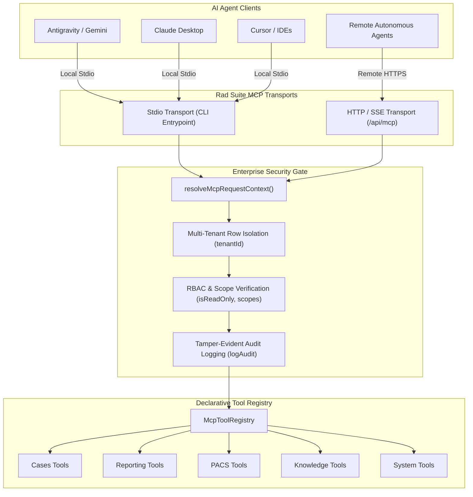

# Model Context Protocol (MCP) & AI Agent Connectivity

This document specifies the enterprise architecture, security governance, multi-tenant isolation, and extensibility patterns for connecting AI agents to **Rad Suite Core** both locally (on-premise workstation) and remotely (cloud VPS).

---

## 1. Architectural Overview & Dual Transports

Rad Suite Core exposes a universal Model Context Protocol (MCP) server supporting two standard transports:

1. **Stdio Transport (`src/mcp/cli.ts`)**:
   - For local AI agents (Antigravity, Claude Desktop, Cursor, local scripts) running on the same machine.
   - Run directly via:
     ```bash
     npm run mcp
     # or
     npx tsx src/mcp/cli.ts
     ```
   - Communicates over standard input and output streams using JSON-RPC 2.0. Standard error (`stderr`) is reserved for diagnostics and telemetry.

2. **HTTP & SSE Transport (`/api/mcp`)**:
   - Native Next.js App Router endpoint at `/api/mcp`.
   - Used for remote agents, cloud VPS deployments, and web orchestrators.
   - Fully secured with Bearer token or `X-API-Key` headers.
   - Handles standard JSON-RPC 2.0 methods (`initialize`, `tools/list`, `tools/call`, `resources/list`, `resources/read`, `prompts/list`, `prompts/get`, `ping`).



---

## 2. Multi-Tenant Isolation & Identity Resolution

Every agent connection resolves into an immutable `McpRequestContext`:
```typescript
interface McpRequestContext {
  userId: string;
  userName: string;
  userRole: UserRole | string;
  tenantId: string;
  tenantCode?: string;
  scopes: string[];
  allowedTools: string[];
  isReadOnly: boolean;
  apiKeyId?: string;
}
```

### Invariants:
1. **Row-Level Tenancy**: All queries (`studies`, `reports`, `patients`) MUST filter by `eq(table.tenantId, ctx.tenantId)`. No agent may cross tenant boundaries.
2. **Identity Traceability**: Every tool call records the authenticated `userId`, `userName`, and `tenantId` in the cryptographically chained audit log (`auditLog`).

---

## 3. Role-Based Access Control (RBAC) & Scoped Keys

Agent API keys support granular scopes:
- `cases:read`: List worklist, inspect clinical study metadata.
- `cases:write`: Claim unassigned cases for reporting.
- `reports:read`: Read findings, impression, and previous revisions.
- `reports:draft_write`: Save structured findings/impression as draft.
- `pacs:query`: Execute C-FIND queries and C-ECHO pings.
- `knowledge:read`: Query eAnatomy structures and Radiopaedia cases.
- `system:read`: Check server and database telemetry.

### Read-Only Mode (`isReadOnly: true`)
When an API key is marked `isReadOnly: true`, all mutating tools (`save_report_draft`, `claim_case`) are automatically excluded from the agent's visible tool list and blocked at execution time with a 403 Forbidden response.

### Strict Draft-Only Mutation (Zero-Submit)
Agents are strictly restricted to `status: 'draft'`. Any attempt to finalize or approve a report is rejected. Final clinical sign-off requires human radiologist action.

---

## 4. How Future Updates Are Streamlined (The Extensibility Pattern)

To add a new tool in future updates, developers only need to create **one file** without modifying the core MCP server or transport layers:

### Step 1: Create Tool Definition
Create `src/mcp/tools/<feature>.tool.ts`:
```typescript
import { z } from 'zod';
import type { McpToolDefinition, McpRequestContext } from '../types';

export const myNewTool: McpToolDefinition = {
  name: 'radsuite_my_new_tool',
  description: 'Description of what this tool accomplishes',
  category: 'cases',
  requiredScope: 'cases:read',
  isMutating: false,
  parameters: z.object({
    caseId: z.string().describe('Case identifier'),
  }),
  handler: async (args, ctx: McpRequestContext) => {
    // Business logic with automatic tenantId scoping
    return { success: true, tenant: ctx.tenantId };
  },
};
```

### Step 2: Register Tool
In `src/mcp/tools/index.ts`, add:
```typescript
McpToolRegistry.registerTool(myNewTool);
```

### Step 3: Inherited Guarantees
The new tool immediately inherits:
- Exposure across both Stdio and HTTP/SSE transports.
- Automatic parameter validation via Zod.
- Scope enforcement and Read-Only blocking.
- Tamper-evident audit logging.
- Tenant-level admin enablement toggling.

---

## 5. Client Configuration Guides

### A. Claude Desktop Configuration
Add to `claude_desktop_config.json`:
```json
{
  "mcpServers": {
    "radsuite": {
      "command": "node",
      "args": ["d:/Projects/Rad-Reporting/rad-suite-core/node_modules/tsx/dist/cli.mjs", "d:/Projects/Rad-Reporting/rad-suite-core/src/mcp/cli.ts"],
      "env": {
        "RADSUITE_API_KEY": "rs_live_your_api_key_here",
        "DEFAULT_TENANT_ID": "tnt_lgh"
      }
    }
  }
}
```

### B. Antigravity & Agent Config
Add to your project or user `.gemini/antigravity/mcp/` or agent config:
```json
{
  "mcpServers": {
    "radsuite": {
      "command": "npm",
      "args": ["--prefix", "d:/Projects/Rad-Reporting/rad-suite-core", "run", "mcp"],
      "env": {
        "RADSUITE_API_KEY": "rs_live_your_api_key_here"
      }
    }
  }
}
```

### C. Remote VPS / Cloud Connection (HTTP JSON-RPC)
```bash
curl -X POST https://your-radsuite-domain.com/api/mcp \
  -H "Content-Type: application/json" \
  -H "X-API-Key: rs_live_your_api_key_here" \
  -d '{
    "jsonrpc": "2.0",
    "id": 1,
    "method": "tools/call",
    "params": {
      "name": "radsuite_get_worklist",
      "arguments": { "modality": "CT", "limit": 5 }
    }
  }'
```

---

## 6. Admin Key Management Endpoints

- `GET /api/admin/mcp/keys`: List all active and revoked agent keys.
- `POST /api/admin/mcp/keys`: Generate a new scoped agent key (`name`, `role`, `scopes`, `allowedTools`, `isReadOnly`, `expiresInDays`).
- `DELETE /api/admin/mcp/keys?id=<id>`: Instantly revoke an agent key.
- `GET /api/admin/mcp/tools`: List all registered tools and their tenant-level activation status.
- `PATCH /api/admin/mcp/tools`: Toggle disabled tools for a tenant (`{ "disabledTools": ["radsuite_claim_case"] }`).
