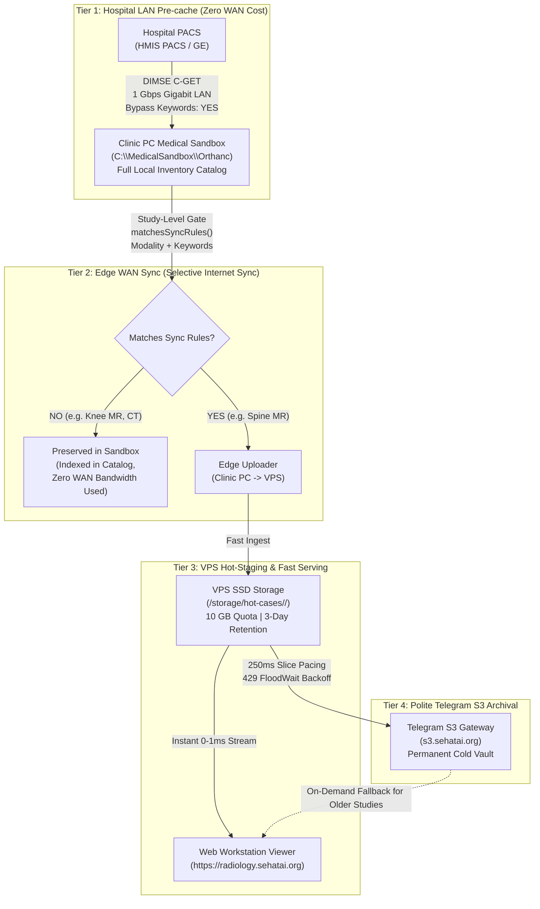

# Two-Tier PACS Ingestion, Edge Bandwidth & Fast VPS Serving

## Overview

Rad Suite employs a strict **Two-Tier Edge Ingestion Pipeline** coupled with **VPS Hot-Staging** and **Polite Cloud Archival**. This architecture guarantees zero hospital network congestion, minimizes upstream internet bandwidth usage, provides instant sub-millisecond web viewing for radiologists, and prevents cloud storage rate limits.

---

## 1. Pipeline Architecture & Tiers

---

## 2. Invariants & Rules of Engagement

### Tier 1: Hospital LAN Harvest (`harvestSchedule`) & PACS Anti-Choking Guard
- **Zero Internet Traffic**: Operates strictly within the hospital's local network over Gigabit LAN.
- **Anti-Choking Invariant**: `harvestSchedule.bypassKeywords = true` is **strictly prohibited during daytime scanning shifts (08:00–17:00)**. Pulling multi-thousand slice contrast exams monopolizes the hospital PACS association pool (limited to 2–5 threads), crashing port 8040 (`ECONNREFUSED`) and blocking incoming Siemens MRI/CT console auto-pushes.
- **Mandatory Focused Filtering**: Daytime harvest MUST strictly filter by modality (`MR`) and clinical keywords (`spine`, `cervical`, `lumbar`, etc.) so transfers finish in 15–30s without starving modality pushes. Full unthrottled inventory crawls are restricted to off-peak night shifts (>20:00). Reference: [`docs/architecture/hospital-pacs-stability-and-vitrea.md`](hospital-pacs-stability-and-vitrea.md).
- **Local Inventory Catalog**: Every downloaded study is cataloged in `local-inventory.js` and reported in node heartbeats, allowing the radiologist to see the hospital case list on the Web UI.

### Tier 2: Selective Edge WAN Upload (`syncRules`)
- **Bandwidth Conservation**: Governed strictly by `syncRules.allowedModalities` and `syncRules.descriptionKeywords` (e.g., `spine`, `brain`, `mrcp`, `musculoskeletal`).
- **Study-Level Gate Invariant**: In `pacs-harvester.js` (`syncLocalOrthancStudies`), `matchesSyncRules()` is evaluated at the **study level** before generating any slice tasks or enqueuing study uploads.
- **Preserved in Sandbox**: Studies that do not match the sync rules (e.g., a Knee MRI when only Spine is selected) remain safely stored in the Orthanc sandbox on the Clinic PC. They are never uploaded over the internet, saving valuable uplink bandwidth.
- **Manual On-Demand Pull**: A radiologist can click "Fetch Accession" on any non-synced case in the Web UI to force an immediate on-demand upload.

### Tier 3: VPS Hot-Staging & Web Workstation Serving
- **Pipeline Milestone Icon**: `public/vps_hotstorage.svg` (`VpsHotStorageIcon`).
- **Mandatory Hot Staging Extraction Invariant**:
  - Web browser diagnostic viewers (Cornerstone3D/OHIF) fetch images **slice-by-slice** on demand (`GET /api/cases/slice?caseId=...&series=1&index=42`).
  - Storing extracted slices at `/storage/hot-cases/<accession>/series-<sNum>/slice-<idx>.dcm` allows serving individual slices in **< 1ms** directly from NVMe SSD with zero CPU unzip overhead.
  - For desktop reporting in RadiAnt, both `/api/cases/<accession>/download-dicom` and `/api/pacs/download` dynamically package the study into a clean `.zip` archive using unified multi-tier resolution (VPS hot-staging SSD $\rightarrow$ local workstation disk $\rightarrow$ S3 cloud storage), allowing instant 1-click downloads for freshly harvested studies without waiting for S3 sync.
- **Series-Level ZIP Streaming Pipeline**:
  - Rather than uploading individual DICOM slices over high-latency WAN (which suffered from 200–300ms TLS handshakes per slice), Orthanc series archives are streamed directly as consolidated ZIP bundles via `/api/clinic-node/stage-series-zip`.
  - Reduces HTTP round-trips by >99% and boosts edge-to-VPS upload speeds from ~60 KB/s to full line speed (>5 MB/s).
- **Zero Double-Disk Footprint Guarantee**:
  - The incoming stream is written to `/tmp/stage_<hash>.zip`, extracted via native `/usr/bin/unzip` into `/storage/hot-cases/<accession>/<seriesNumber>/` in ~50ms, and the temporary archive is immediately unlinked in a `finally` block.
  - Slices on disk occupy only the uncompressed DICOM size; zero duplicate archive files remain on disk.
- **Retention & Quota Policy**:
  - **10 GB Storage Quota**: High watermark at 8.5 GB (`HIGH_WATERMARK_BYTES`).
  - **3-Day Retention**: Studies older than 3 days are eligible for disk cleanup once archived.
  - **Zero-Loss Protection Invariant**: A study is **strictly protected** and NEVER pruned if:
    1. It was performed today or yesterday (`studyDate === todayDicom || studyDate === yesterdayDicom`).
    2. It has not yet completed syncing to S3 (`isSyncedToS3 === false`).

### Tier 4: Single Study ZIP Cloud S3 Archival
- **Pipeline Milestone Icon**: `public/cloud_s3_coldstorage.svg` (`CloudS3ColdStorageIcon`).
- **Single-Object Study ZIP Invariant**:
  - The background archiver (`hot-case-archiver.service.ts`) packages the completed study directory into a single optimized Study ZIP:
    `dicom/${year}/${month}/${mod}/${accession}_${patientName}_${studyUid}.zip`
  - Uploads the Study ZIP in **1 single HTTP PUT request** along with a companion `${accession}.manifest.json`.
  - Completes archival in **2–4 seconds** per study instead of minutes of iterative slice PUTs.
- **Zero Rate Limits**: Single-object PUTs eliminate Telegram S3 Bot API `429 FloodWait` rate limits and Cloudflare Worker row scan caps.
- **Transparent LRU Re-Hydration**: If a radiologist accesses an older case purged from VPS hot storage, `s3-retrieval.service.ts` auto-hydrates by downloading the Study ZIP from S3, extracting to `/storage/hot-cases/<accession>/`, and serving slices to the web viewer in 0ms. RadiAnt downloads also directly stream the pre-compiled Study ZIP from S3 in 1 request.

---

## 3. Unified Clinic Node Settings & Master Save Bar
- **Single Master Save Bar**: Replaces scattered per-card save buttons with a single sticky action bar (`ClinicSaveBar`) at the bottom of `/settings?tab=clinic-node`.
- **Dirty State Tracking**: Automatically detects unsaved changes across PACS Harvester, S3 Sync, Cluster/Watchdog, and Operational Hours, highlighting modified sections.
- **Atomic Mutation**: Clicking "Save All Settings" dispatches `save-all-settings` to update all node configurations in one atomic API transaction. Discard immediately rolls back to current live telemetry.

---

## 3. Edge Configuration Handshake & State Authority

To prevent race conditions between web UI mutations and 5-second edge heartbeats:
1. **Server Authoritative State**: `rad-suite` and `clinic-gateway` treat server-stored configuration (`syncRules`, `harvestSchedule`, `autoRetention`) as authoritative.
2. **Anti-Clobbering Protection**: Incoming heartbeats from Clinic PC nodes report status and telemetry, but are **forbidden** from overwriting server-configured sync rules with stale edge configs.
3. **Bi-Directional Reconciliation**: Authoritative `settings` are returned in every heartbeat HTTP response. The Clinic PC inspects `settings`, atomically writes changes to `clinic-config.json`, and reconciles its runtime schedulers.

---

## 4. Modality Inference, RadiAnt Description Resolution & Workstation Filtering

### Modality Inference & Identity Invariant
- **Series-Level Modality Tag Resolution**: Because DICOM `Modality` tag (0008,0060) is Series-level and often missing at the Study level in Orthanc, edge and server ingestion pipelines use `inferModality()` (`@/lib/modality-inference`) to infer the true modality from `MainDicomTags.StudyDescription`, first series tags, and patient name cues instead of blindly falling back to `MR`.
- **Composite Unique Index Safe Lookup**: `(accession_number, modality)` index ensures distinct modalities (e.g. CT and MR) sharing the same accession number can coexist without collision or overwriting.

### RadiAnt-Style Description Hierarchy
- When hospital study descriptions are blank or generic (`CT Study`, `MR Study`, `STUDY`), `resolveClinicalDescription()` resolves clinical titles using:
  1. `SeriesDescription` (0008,103E) or `ProtocolName` (0018,1030).
  2. Patient name clinical abbreviations (e.g., `KUB NC`, `BRAIN 3D`, `L/S 3D`, `LT KNEE`, `COD`).
  3. Formatted anatomical titles (e.g., `MRI L/S Spine`, `CT Brain Plain`).

### Cross-Screen Filter Harmonization & Interactive Sorting
- **`matchesModality()` Utility**: Harmonizes modality filtering across `/pacs`, `/patients`, `/hmis`, and `/worklist`, equating `MR` and `MRI`, as well as `CR`, `DX`, and `XR`.
- **Decluttered Workstation Header**: Streamlined title and direct Settings gear icon link to `/settings?tab=clinic-node`, eliminating raw IPs, verbose text, and redundant quick banners.
- **Interactive Column Sorting**: Column headers in `PacsUnifiedTable` support click-to-sort (patient name, modality, description, slice count, acquisition date) with directional Chevron indicators. Duplicate "Source" column is removed in favor of status indicators in the Series/Slices column.

