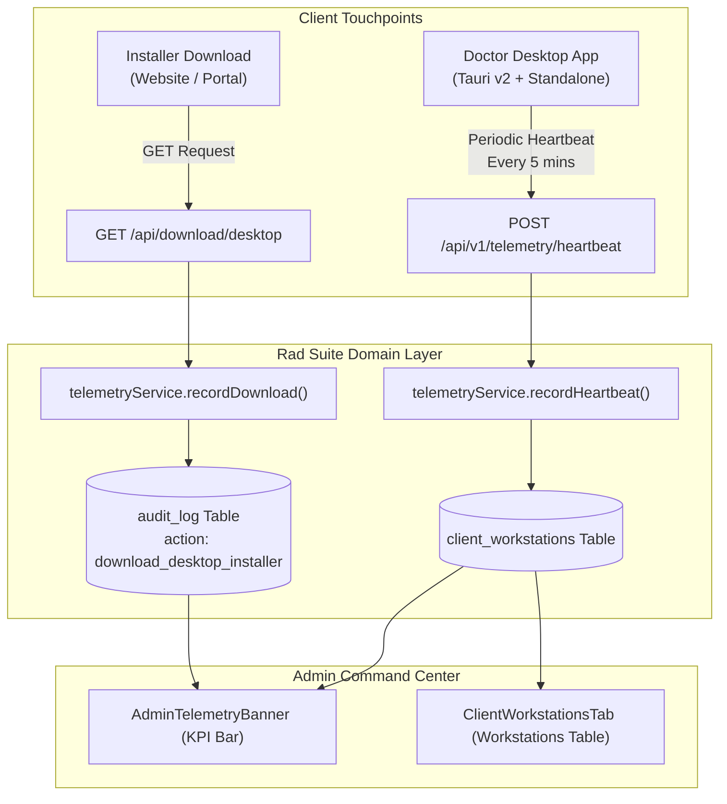

# Admin System Telemetry & Workstation Client Tracking

This document specifies the real-time client workstation tracking, active doctor session telemetry, download metrics, and administrative command center overview in **Rad Suite**.

---

## 1. System Telemetry Architecture

Rad Suite provides hospital administrators with end-to-end visibility into:
1. **Registered Clinicians**: Total doctor accounts, active practitioners, and alpha waitlist applicants.
2. **Desktop Workstations**: Real-time inventory of physical diagnostic workstation installs, online/offline status, and operating system specifications.
3. **Clinic Edge Nodes**: Live status of hospital clinic PCs running `clinic-agent.js` and Orthanc DICOM daemons.
4. **Installer Downloads**: Tamper-evident download counts and distribution versions.



---

## 2. Workstation Heartbeat Protocol

### Endpoint: `POST /api/v1/telemetry/heartbeat`
- **Authentication**: Automatically attaches active clinician session if logged in; accepts anonymous hardware heartbeats before login.
- **Payload Schema (`WorkstationHeartbeatSchema`)**:
  ```typescript
  {
    machineId: string;       // Unique hardware UUID persisted in localStorage
    hostname?: string;       // Workstation computer name
    platform: 'windows' | 'macos' | 'linux';
    osVersion?: string;      // User agent / OS version string
    appVersion: string;      // e.g. "1.0.1"
    specs?: {
      cpuCores?: number;
      gpuAccelerated?: boolean;
      arch?: string;
    };
  }
  ```

### Online/Offline Determination:
- A workstation is marked **Online (🟢)** if its `last_seen_at` timestamp is within the last **15 minutes**.
- If no heartbeat is received for > 15 minutes, the workstation automatically transitions to **Offline (⚪)**.

---

## 3. Installer Download Auditing

When a clinician downloads `Rad Suite_1.0.1_x64-setup.exe` via `/api/download/desktop`:
1. The request triggers a non-blocking `telemetryService.recordDownload()` call.
2. A cryptographic audit record is inserted into `audit_log`:
   - `action`: `'download_desktop_installer'`
   - `entityType`: `'System'`
   - `entityId`: `'Rad Suite_1.0.1_x64-setup.exe'`
   - `ipAddress`: Remote client IP address
   - `userAgent`: Client operating system & browser agent
3. The total downloads counter on the Admin Dashboard is instantly updated.

---

## 4. Presentation & User Experience

### 1. Admin Telemetry Banner (`AdminTelemetryBanner.tsx`)
- Displayed prominently at the top of `/users` and `/dashboard` for administrator accounts (`role === 'admin'`).
- 4 Responsive Bento Cards:
  - **Registered Clinicians**: Total doctors, active count, and pending waitlist badge.
  - **Desktop Workstations**: Total installed client workstations and live online count with pulsing green indicator.
  - **Clinic Edge Nodes**: Online Orthanc LAN harvesters out of total configured nodes.
  - **Workstation Downloads**: All-time total downloads with latest download date.

### 2. Client Workstations Inventory Tab (`ClientWorkstationsTab.tsx`)
- Located in `/users` under the **Workstations** tab.
- Live search by computer hostname, machine ID, active doctor name, or IP address.
- Instant filter pills: `All`, `Online`, and `Offline`.
- Displays detailed hardware attribution, app version, last logged-in clinician, and timestamp.
