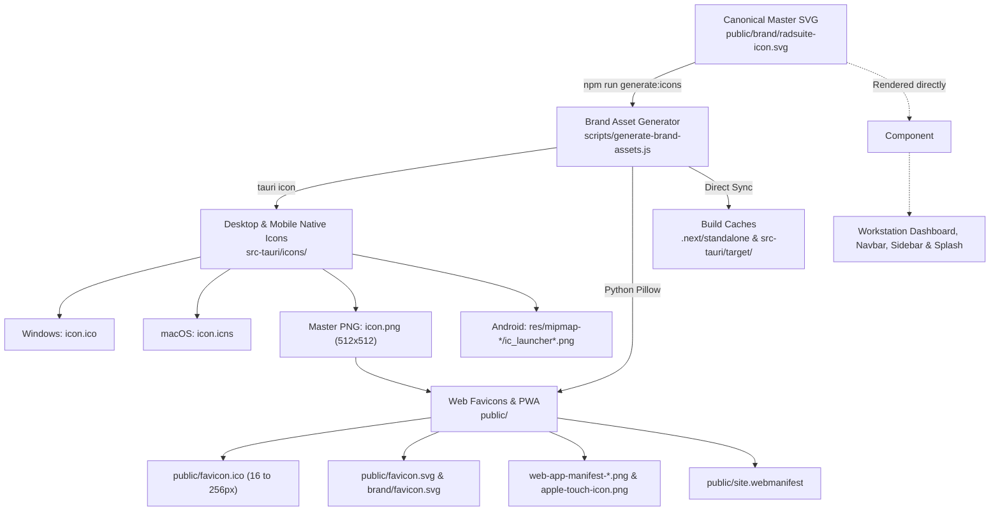

# Rad Suite Brand Identity & Single-Source Icon Architecture

This document specifies the single-source-of-truth brand architecture, color schemes, and automated icon generation pipeline across web, desktop (Tauri), and mobile (Android) applications.

---

## 1. Architectural Philosophy: Single Source of Truth

Previously, icon and brand assets were scattered across multiple disparate directories (`public/favicon.ico`, `public/favicon.svg`, `public/brand/*.svg`, `src-tauri/icons/*`, and `src/components/brand/radsuite-logo.tsx`). Over time, this caused visual drift where the web favicon reverted to blue/cyan while the workstation dashboard used clinical green.

To prevent drift and eliminate manual per-file replacements, Rad Suite enforces:
1. **Canonical Master SVG**: [`public/brand/radsuite-icon.svg`](../../public/brand/radsuite-icon.svg) is the sole source of truth for the brand mark.
2. **Component Direct Binding**: `<RadSuiteLogo />` directly loads `/brand/radsuite-icon.svg`, ensuring instantaneous parity with zero redundant SVG code.
3. **Automated Multi-Platform Generation**: One command (`npm run generate:icons`) derives and synchronizes all web favicons, desktop executables, PWA manifests, and Android mipmap icons.

---

## 2. Official Brand Palette: Clinical Sage & Emerald

The workstation uses a clinical radiology color palette optimized for high-contrast dark diagnostic environments:

| Element | Hex Color | Role / Description |
| :--- | :--- | :--- |
| **Primary Mark** | `#8ecf9e` | **Sage Mint**: Aperture pillar, upper loop, gantry ring, laser reticle crosshairs. |
| **Secondary Mark** | `#4a7c59` | **Clinical Emerald**: Dynamic diagonal scan leg and inner helical gantry ring. |
| **Obsidian Dark** | `#101419` | **Obsidian Slate**: Deep dark container background. |
| **Container Border**| `#252b35` | **Muted Slate Rim**: Subtle 2px container outline. |
| **Focal Core** | `#ffffff` | **Luminous Center**: Diagnostic core with `#8ecf9e` halo. |

*Note: The legacy cyan/blue palette (`#38bdf8`, `#0284c7`) is permanently deprecated for Rad Suite brand marks.*

---

## 3. Asset Pipeline & Generation Flow



---

## 4. Generated Asset Inventory

| File Path | Format / Size | Target Platform / Usage |
| :--- | :--- | :--- |
| `public/brand/radsuite-icon.svg` | SVG (128x128) | **Canonical Master Source of Truth**. |
| `public/favicon.ico` | Multi-res ICO (16-256px) | Browser fallback & desktop shortcuts. |
| `public/favicon.svg` | SVG (32x32) | Modern browser tabs (crisp vector rendering). |
| `public/favicon-96x96.png` | PNG (96x96) | High-DPI browser tab icon. |
| `public/apple-touch-icon.png` | PNG (180x180) | iOS home screen bookmarks. |
| `public/web-app-manifest-*.png` | PNG (192x192, 512x512) | Progressive Web App install icons. |
| `public/site.webmanifest` | JSON Web Manifest | PWA standalone installation manifest. |
| `public/brand/radsuite-logo.svg` | SVG (380x84) | Horizontal brand lockup (Dark theme). |
| `public/brand/radsuite-logo-light.svg`| SVG (380x84) | Horizontal brand lockup (Light theme). |
| `src-tauri/icons/icon.ico` | Windows ICO | Windows `.exe` packaging & taskbar icon. |
| `src-tauri/icons/icon.icns` | macOS ICNS | macOS `.dmg` / `.app` bundle icon. |
| `src-tauri/icons/icon.png` | PNG (512x512) | Linux desktop `.AppImage` / metadata. |
| `src-tauri/icons/Square*Logo.png` | Appx PNGs | Windows Store / MSIX packaging tiles. |
| `src-tauri/gen/android/...` | Mipmap PNGs | Android native APK launcher (`ic_launcher`). |

---

## 5. How to Update Brand Icons (1-Step Workflow)

To change the icon or test a new brand concept, choose either workflow:

### Option A: In-Place Edit (Recommended)
Edit [`public/brand/radsuite-icon.svg`](../../public/brand/radsuite-icon.svg), then execute:
```bash
npm run generate:icons
```

### Option B: External File Input
Provide any new SVG or PNG file path directly:
```bash
npm run generate:icons path/to/new-logo.svg
```

The generator will:
1. Update `public/brand/radsuite-icon.svg` as the new master source.
2. Recompile all desktop icons, Appx logos, ICNS, and Android mipmap launcher icons via Tauri.
3. Generate multi-resolution `favicon.ico`, `favicon.svg`, `favicon-96x96.png`, and Apple touch icons via Pillow.
4. Update `site.webmanifest` and synchronized build caches (`.next/standalone`, `src-tauri/target`).

---

## 6. Automated Quality & Invariant Tests

All brand assets are guarded by automated tests in [`src/services/__tests__/brand-assets-single-source.test.ts`](../../src/services/__tests__/brand-assets-single-source.test.ts):
- Asserts master SVG contains the clinical green palette (`#8ecf9e` / `#4a7c59`) and rejects deprecated blue (`#38bdf8`).
- Asserts web favicons, desktop `.ico`, `.png`, and `.icns` exist and are populated.
- Asserts `<RadSuiteLogo />` stays bound to `/brand/radsuite-icon.svg`.
- Asserts Next.js `layout.tsx` metadata registers the multi-resolution `.ico`, `.svg`, and `.webmanifest`.
