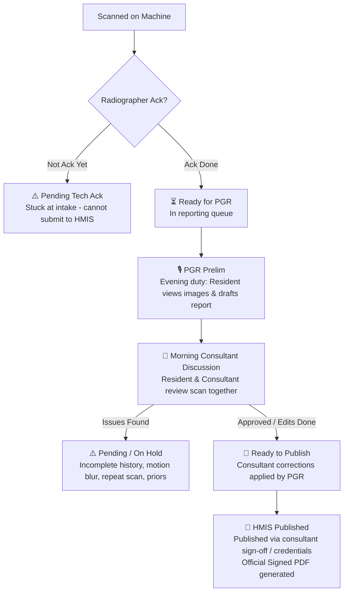

# Resident (PGR) & Consultant Clinical Lifecycle Plan

> **For Claude:** REQUIRED SUB-SKILL: Use superpowers:executing-plans to implement this plan task-by-task.

**Goal:** Model Dr. Mudassir's exact hospital daily workflow at LGH (Evening duty PGR prelims $\rightarrow$ Morning consultant review $\rightarrow$ Pending on hold vs Approved edits $\rightarrow$ HMIS publishing with signed PDF), while automating status detection for previously unacknowledged cases and published studies.

---

## 1. Exact Clinical Workflow Mapping

Your daily reporting routine is now the single source of truth for the entire status engine:

### The 6 Distinct Clinical States

| State | Badge | Clinical Meaning in Your Shift | Actions Available |
|---|---|---|---|
| **0. Stuck at Intake** | ⚠️ `Pending Tech Ack` | Radiographer has not clicked acknowledge on HMIS; cannot add results yet. | Re-check HMIS status; alert tech. |
| **1. Ready for Duty** | ⏳ `Ready for PGR` | Radiographer acknowledged; available in Proceeded queue for reporting. | Open viewer, start reporting. |
| **2. Evening Duty** | 🎙️ `PGR Prelim` | Dr. Mudassir reviewed images and wrote provisional resident findings. | Edit findings, prepare for morning discussion. |
| **3. Clinical Hold** | ⚠️ `Pending (Reason)` | Held during morning discussion: incomplete history, motion artifacts, repeat scan, or missing lab records. | Quick modal to record reason (History, Blur, Priors). |
| **4. Approved Edits** | 📝 `Ready to Publish` | Discussion complete, consultant edits entered; ready for portal submission. | One-click publish to HMIS draft/portal. |
| **5. Portal Published** | 📜 `HMIS Published` | Report finalized & signed by consultant (e.g. Dr. Fariha Sadaf). | 1-Click download of official **Signed PDF**. |

---

## 2. Harmonizing Header, Top Stats & Table ("All Stay the Same")

To eliminate all confusion, the exact same labels and badges appear everywhere:

1. **Table Header Column**: **`STATUS & LIFECYCLE`** (Sorts by clinical workflow).
2. **Top Summary Counters**:
   - `[ 1087 Total ]`
   - `[ ⚠️ 12 Pending Tech Ack ]`
   - `[ 🎙️ 44 PGR Prelims ]`
   - `[ ⚠️ 8 On Hold / Pending ]`
   - `[ 📜 43 Published ]`
3. **Filter Dropdown**: Matches the exact clinical states:
   - `All Lifecycle States`
   - `⚠️ Pending Tech Ack (Stuck at Intake)`
   - `⏳ Ready for PGR (Acknowledged)`
   - `🎙️ PGR Prelim (Duty Drafts)`
   - `⚠️ On Hold (History / Artifacts / Repeats)`
   - `📝 Ready to Publish (Edits Done)`
   - `📜 Published on HMIS (Signed PDF)`
4. **Table Row Badges**: Displays the matching 2-tier clinical pill with zero extra columns.

---

## 3. Automated Tracking for Your Cases ("Did They Get Acknowledged or Published?")

You mentioned two critical scenarios from your last shift:
1. *Cases that could not be published because the radiographer hadn't acknowledged them.*
2. *Cases you already drafted and discussed that consultants may have published.*

### How Auto-Detection Works (Without Manual Digging):
When you open `/my-cases` or click **`Check My Cases Status`**:
- **Check A (Did radiographer acknowledge my stuck cases?)**:
  - The system queries HMIS Proceeded Patients and Tracking.
  - If a case that was previously `⚠️ Pending Tech Ack` is now acknowledged by the tech, the status **automatically updates to `⏳ Ready for PGR`**!
- **Check B (Did the consultant publish my prelim report?)**:
  - The system checks HMIS Published Reports.
  - If the accession appears with the consultant's verification (e.g., Dr. Fariha Sadaf), the status **automatically promotes to `📜 HMIS Published`** and attaches the direct signed PDF download link!
- **Zero Overhead**: This check only scans your claimed/authored cases (typically 5–20 cases), executing in ~2 seconds without lagging the rest of the workstation.

---

## 4. UI Cleanliness (No Extra Columns)

- **Column 4 (`DATE & ORIGIN`)**: Cleaned up to show strictly date of scan, duty timestamp, and modality origin. No HMIS badges crammed here.
- **Column 5 (`STATUS & LIFECYCLE`)**: Sleek, unified 2-tier clinical pill:
  - **Row 1**: Clinical Reporting Phase (`🎙️ PGR Prelim` / `⚠️ Pending Reason` / `📝 Ready to Publish` / `📜 HMIS Published`)
  - **Row 2**: Portal Sync State (e.g. ⚠️ `Awaiting Radiographer Ack` or 📄 `Signed PDF Available`)
  - **Row 3**: Ownership tag (`⭐ Yours` or `🔒 Assigned`) + `Release` button.

---

## 5. Proposed File Changes

### Presentation Layer
1. `src/components/worklist/worklist-reporting-view.tsx`: Table header label $\rightarrow$ `Status & Lifecycle`.
2. `src/components/worklist/worklist-lifecycle-cell.tsx` (NEW, <220 lines): Unified 2-tier clinical cell.
3. `src/components/worklist/worklist-row-item.tsx`: Remove misplaced HMIS badge from Column 4, mount `WorklistLifecycleCell` in Column 5.
4. `src/components/worklist/worklist-status-dropdown.tsx`: Align filter options to the 6 clinical states.
5. `src/components/worklist/worklist-status-action-menu.tsx`: Match menu actions (`PGR Prelim`, `Pending Hold`, `Ready to Publish`, `Published`).
6. `src/app/(dashboard)/worklist/page.tsx` & `src/app/(dashboard)/my-cases/page.tsx`: Synchronize top summary badges.

### Domain & Transport Layer
7. `src/app/api/cases/sync-my-cases-status/route.ts` (NEW, <100 lines): Background status probe for your active cases.
8. `src/services/hmis/hmis-worklist-sync.service.ts`: Update status transitions to support `pending_tech_ack` vs `proceeded` vs `published`.
9. `src/hooks/use-my-cases.ts`: Add automated light status sync on mount and toolbar refresh button.

---

## 6. Verification Plan
- **Typecheck**: `npm run typecheck` $\rightarrow$ 0 errors.
- **Automated Tests**: Vitest suite for status state machine and table rendering.
- **File Size Cap**: Verify all files strictly $<300$ lines.
- **Live Hospital Case Verification**:
  - Test Accession `192610008123` $\rightarrow$ Detects `📜 Published` with Dr. Fariha Sadaf sign-off and signed PDF.
  - Test unacknowledged intake cases $\rightarrow$ Detects `⚠️ Pending Tech Ack`.
